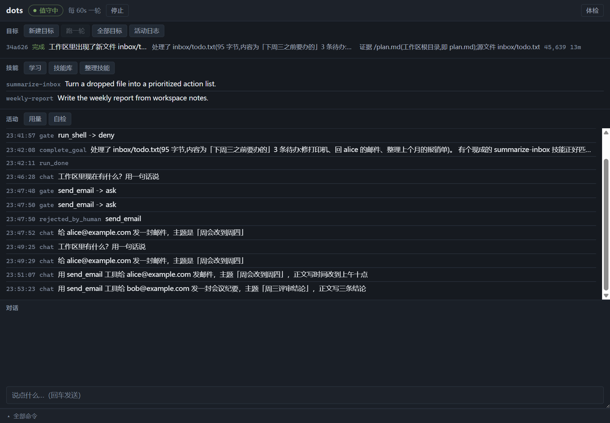
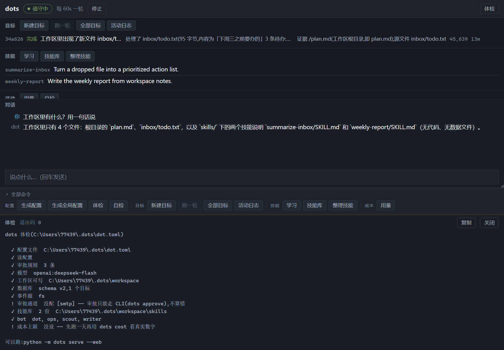
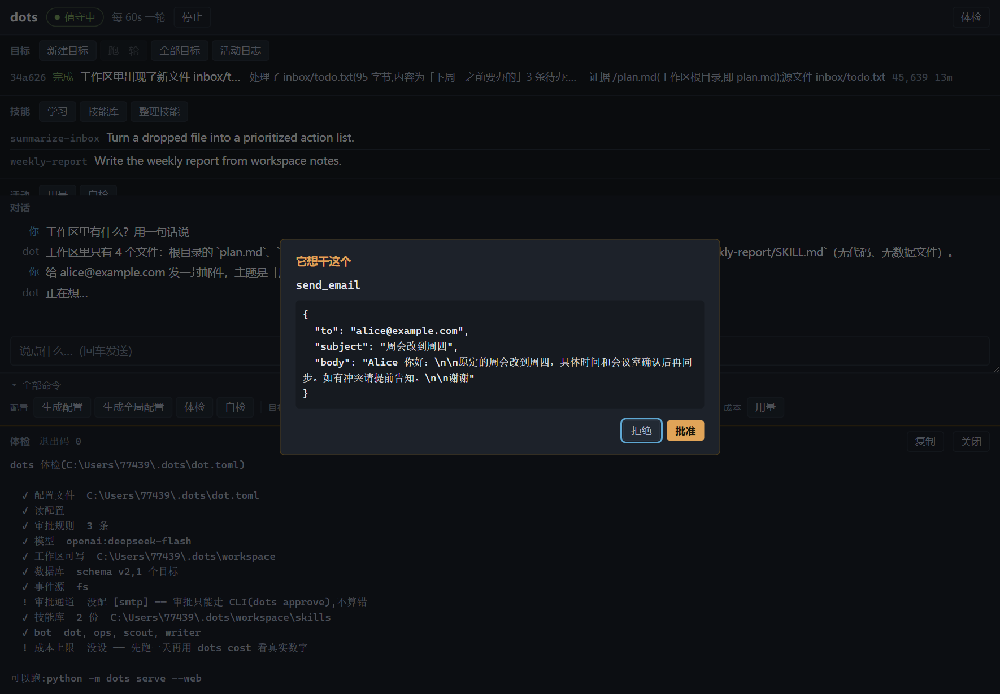
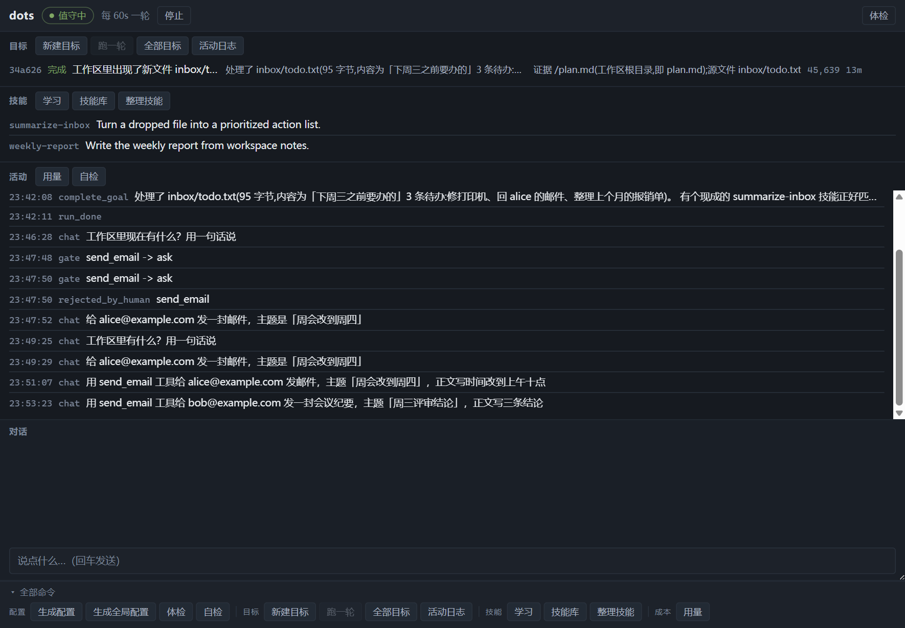
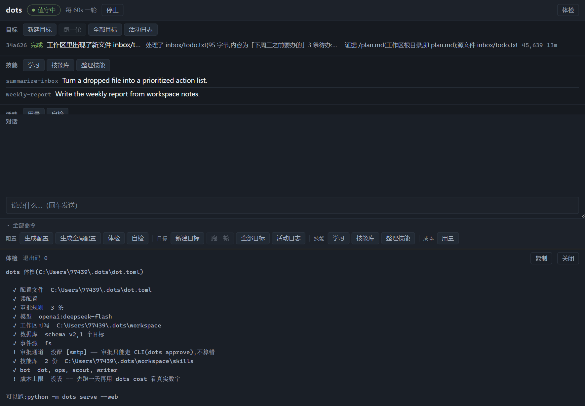

# dots-agent

一个会主动发现任务、主动积累技能的智能体。

包名 `dots-agent`,命令是 `dots`(装完就有)。两种用法:**命令行**,或者 **Windows 桌面窗口**。



## 安装

### 命令行

```bash
pip install dots-agent
```

> 国内镜像(清华、阿里等)同步新包有延迟,刚发布的几天可能报
> `No matching distribution found`。加官方源即可:
>
> ```bash
> pip install dots-agent -i https://pypi.org/simple
> ```

或者不装,直接在仓库里跑(两种方式命令都通用):

```bash
git clone https://github.com/duyongan/dots-agent
cd dots-agent
python -m dots serve
```

### 桌面版(Windows)

安装包在仓库的 `release/` 下:

```text
release/dots-0.1.0-setup.exe
```

双击安装。安装器是**按用户安装**,不需要管理员权限,默认装在:

```text
%LOCALAPPDATA%\Programs\dots
```

安装过程中可以改目录;会创建桌面快捷方式和开始菜单项。卸载走 Windows 的
「设置 → 应用 → 已安装的应用 → dots」。

安装包自带一份嵌入式 Python 和全部依赖(`resources/runtime/`),**机器上没装过 Python 也能跑**。

在仓库里开发桌面版:

```bash
cd desktop
npm start
```

开发模式不打包,直接用系统上的 Python;工作目录是仓库根,所以会读仓库根或 `~/.dots/`
下的 `dot.toml`。

## 快速开始

```bash
dots init --global         # 配一次,以后 cd 到哪都能敲 dots
dots doctor                # 体检一下
dots goal "把 inbox 里的东西整理成一份报告"
dots serve --web           # 常驻跑起来,同时开活动视图
```

`--global` 把配置写到 `~/.dots/`,数据和 `workspace/` 也跟着放那儿 ——
一份到处用,换个目录不用再 init。不带参数就是 `dots init`,只写当前目录,
那样每个目录都得配一次。

也可以不带子命令,直接进交互终端。里面**直接打字就是和它说话**,
`/` 开头才是命令:

```
$ dots
dots> 工作区里现在有什么?帮我看看该先处理哪件事
      (它自己去翻文件,然后回你)

dots> /goal "把 inbox 整理成一份周报"     ← 交给后台慢慢跑
dots> /ls
dots> /exit
```

| 输入 | 干什么 |
|---|---|
| 直接打字 | 和它对话。**记得上下文**,能接着追问 |
| `/命令` | 命令行那些命令,前面加个 `/`(见下表) |
| `/help` | 看全部命令 |
| `/exit` | 退出(Ctrl-D、Ctrl-C 也行) |

对话走的是同一个大脑、同一个工作区,但它**不是目标**:不进 `dot ls`,
后台 tick 也不碰它,所以不会算进你的目标队列。要让它后台跑,用 `/goal`。
它想在对话里做 `ask` 类动作(比如发邮件)时会当场问你 y/n,不走邮件审批。

每条命令都会重新读一遍配置,所以改完 `dot.toml` 不用退出来重进。

打开 http://127.0.0.1:8765/ 看它在干什么。

想先不配模型试一遍:

```bash
dots selftest              # 不联网、不调模型
```

## 桌面界面

一个窗口装下 `dots` 的全部日常操作:看它在干什么、给它派活、批准它想做的事、跟它说话。
不用开终端,不用背命令。它和命令行版共用同一份配置、同一个数据库、同一个工作区。

### 第一次启动前必须先有配置

这是最容易卡住的一步:

> **后端找不到 `dot.toml` 会直接退出**,界面顶栏变成「后端已停」,所有按钮变灰。
> 此时连「生成全局配置」也点不动 —— 那个按钮要求后端已经就绪。

所以第一次使用,先在终端里生成一份全局配置:

```bash
pip install -e .          # 或按上面的方式安装 dots-agent
dots init --global        # 写到 ~/.dots/dot.toml
dots doctor               # 体检,确认模型、目录、数据库都没问题
```

`dots init` 会自动探测环境变量里的模型 key。没探到就手填 `~/.dots/dot.toml` 的 `[model]` 段。

打包版查找配置的顺序:

1. `%APPDATA%\dots-desktop\dot.toml`(也就是应用的当前工作目录)
2. `~/.dots\dot.toml`

你的数据跟着配置文件走:全局配置在 `~/.dots/`,数据库和工作区也都在那儿。

### 启动过程

双击图标后:

1. Electron 先画窗口;
2. 拉起 `python -m dots bridge`;
3. 后端导入 langchain 那一整串依赖,**约 10 秒**;
4. 后端发出 `ready`,顶栏从「正在启动后端…」变成「值守中」。

这 10 秒里输入框和按钮是灰的。**不是卡死**。不要在这个时候狂点 —— 虽然界面会拦住,
但后端准备好之前发的命令会堆在管道里,顺序不可控。

如果后端起不来,顶栏显示「后端已停」,同时底部弹出输出面板,里面是 Python 的 stderr
尾部(常见的:「没找到配置」「ModuleNotFoundError」「API key 缺失」)。

### 界面总览

窗口从上到下五段:

```text
┌────────────────────────────────────────────────────┐
│ 顶栏:dots  ● 值守中  每 60s 一轮  [停止]   [体检]  │
├────────────────────────────────────────────────────┤
│ 待批横幅(只在有事等你时出现)                       │
├────────────────────────────────────────────────────┤
│ 目标        │ 技能          │ 活动                  │
│ (三栏监控区)                                        │
├────────────────────────────────────────────────────┤
│ 对话                                                │
│ 你/它 的消息……                                      │
│ [ 说点什么…(回车发送)                        ]      │
├────────────────────────────────────────────────────┤
│ ▴ 全部命令(展开后是一整排中文按钮)                 │
└────────────────────────────────────────────────────┘
```

窗口最小 720×520。窗口高度不足 640px 时,命令抽屉会自动收起且把手不可点,
保证上面的内容不被挤没。

### 顶栏:状态与值守开关

后端状态:

| 文字 | 含义 |
|---|---|
| 正在启动后端… | Python 子进程正在导入依赖,按钮全灰 |
| 值守中 | 后端就绪,可以操作 |
| 正在停止… | 正在优雅退出后端 |
| 后端已停 | 进程退出或起不来,详情看输出面板 |

顶栏中间显示:

- `每 60s 一轮`:循环在跑。数字来自 `[dot] tick_seconds`。
- `循环已停`:循环没跑,但后端还活着,你仍然可以手动「跑一轮」、聊天、点命令。

右边按钮:

- **停止**:请求停下循环。如果它正跑着一个目标,**不会立刻停** —— 要等这一轮结束。
  按钮会一直是「停止」,直到后端推来 `loop_stopped`。急着关窗口也没事,
  关闭时会先把没跑完的目标放回队列。
- **开始值守**:重新启动循环。

循环默认在界面启动时自动开启。它的存在感就是「主动」:不用你喊,它每轮自己找活干。

顶栏最右边「体检」= `dots doctor`。逐项检查:配置文件、读配置、审批规则、依赖、模型、
工作区可写、数据库、事件源、审批通道、技能库、bot、成本上限。每项失败都会给一句
「下一步怎么做」。

### 待批横幅:它停下来等你

只有存在挂起审批时才出现,是整个界面唯一用琥珀色强调的地方。

```
⚠ a7f3 想发邮件给 alice:「周会改到周四」  (还有 2 个)
   a7f3 [批准] [拒绝]   b91c [批准] [拒绝] …
```

- 摘要会尽量说人话:`send_email` 显示收件人和主题,`run_shell` 显示命令,
  其它动作显示工具名。
- 每个审批有唯一编号(token)。点「批准」= `dots approve <token>`,
  「拒绝」= `dots reject <token>`。
- 决定写进 `approvals` 表,下一轮 tick 自动续跑对应目标。邮件回复和这里点按钮
  **走的是同一条路径**。
- 一直不批:超过 `[approval] timeout_hours`(默认 72 小时)自动按**拒绝**处理。
  这比无限等待好 —— 一个永远等不到回复的审批就是一个悄悄卡死的目标。

哪些动作需要批,由 `dot.toml` 的 `[approval.rules]` 决定:

```toml
[approval.rules]
send_email = "ask"     # 挂起,等人批
save_skill = "allow"   # 直接执行
run_shell  = "deny"    # 永不执行
```

没写到的动作一律 `ask`(默认从严)。

### 目标面板

目标 = 一件要它做的事。每行显示:

| 列 | 含义 |
|---|---|
| 编号 | 目标 id,也是交接/日志里的标识 |
| 状态 | 见下表 |
| 目标原文 | 你写的或它自己派生的任务 |
| 结论 | agent 完成时给的 summary |
| 证据 | 工作区路径、邮件 id、URL 等可核对的东西 |
| 数字 | 这个目标累计消耗的 token |
| 时间 | 最后更新的时间(`12s / 3m / 2h / 2d`) |
| 日志 | 只看这个目标的活动记录 |

七种状态:

| 界面文字 | 内部值 | 含义 |
|---|---|---|
| 待批准 | `pending` | agent 自己派生出来的目标,要你点头才跑 |
| 排队中 | `ready` | 等着被某一轮 tick 领走 |
| 在跑 | `running` | 正在执行 |
| 停下等你 | `interrupted` | 撞上审批闸门,等批准/拒绝 |
| 待复核 | `pending_review` | 它说完成了但**没给证据**,需要人看一眼 |
| 完成 | `done` | 完成且给了证据 |
| 失败 | `failed` | 执行失败 |

「待复核」值得单独说:一个没有证据的结论没法核对,所以不会直接算完成。

面板按钮:

| 按钮 | 等价命令 | 行为 |
|---|---|---|
| 新建目标 | 原生 `goal` | 弹输入框,写进 `goals` 表,状态直接 `ready`(你亲手写进去的,视为授权) |
| 跑一轮 | `dots tick` | 手动跑一轮就退,调试用。循环运行时按钮置灰;后端也会拦住并发的 tick |
| 全部目标 | `dots ls` | 输出完整列表(界面里的 60 条只是快照) |
| 活动日志 | `dots log` | 输出最近 30 条活动 |

「新建目标」走的是 bridge 的原生命令,不是 CLI:不会在输出面板里打印
「跑起来:python -m dots serve」这种在界面里很误导的提示。它固定交给默认 bot `dot`。

目标列表最多显示最近 60 条,多了会静默截断。

### 技能面板

技能是 agent 干活时自己总结出来的可复用流程,存在工作区里,每份是一个目录,
里面有 `SKILL.md`(YAML frontmatter + 正文)。

面板每行显示技能名和一句话描述。技能库是**渐进披露**的:只有「名字 + 描述」每轮会进
系统提示,正文等真用到时才读。所以描述被硬性限制在 **60 字符**,超出部分每轮都会被截断。

| 按钮 | 等价命令 | 行为 |
|---|---|---|
| 学习 | `dots learn <材料或描述>` | 弹输入框;创建一个 `origin=cli:learn` 的 ready 目标,让 agent 把材料总结成技能。**它不会立刻执行**,要等循环或手动跑一轮 |
| 技能库 | `dots skills` | 输出技能表(名称、描述长度、描述) |
| 整理技能 | `dots curate` | 创建整理目标,让 agent 合并重复、删除没价值的。会**真的删改文件**,会先弹确认;技能少于 2 份时命令直接说没什么好整理的 |

每行右侧还有两个小按钮:

- **看**:`dots skill show <名>`,在输出面板里显示 `SKILL.md` 全文。
- **删**:`dots skill rm <名>`,删除整个技能目录。会弹确认,确认按钮写「删掉」。

技能库为空时,面板会提示:它干活时会自己攒,「学习」也能喂材料。

### 活动面板

完整流水:收了事件、建了目标、被哪条规则拦下、什么时候跑完、循环启停、错误栈。

数据来源有两份,合并后按时间排序,最多显示最近 120 行:

1. 数据库 `audit` 表的快照(最近 60 条);
2. 本次运行期间后端实时推来的 `log` / `fatal` / `loop` / 协议错误(最多缓存 300 条)。

每行是 `时间 | 类型 | 详情`。出问题时先看这里。

| 按钮 | 等价命令 | 说明 |
|---|---|---|
| 用量 | `dots cost` | 今日和累计 token 用量 |
| 自检 | `dots selftest` | 不联网、不调模型,跑四个模块的 `demo()` + 全套测试,约 30 秒 |

### 对话区

直接打字就是跟它说话,回车发送。它用的是同一个大脑、同一个工作区:让它读文件、
查资料、写东西,它会真的动手,不是只描述打算怎么做。



特点:

- **不是流式的**:发送后显示「正在想…」,慢模型下可能要等十几秒才出整段回答。
- **有上下文**:对话用固定的 `thread_id = "chat"`,checkpoint 存在 `dot.db` 里,
  **关掉应用再打开,之前的对话还在**。
- **和后台目标是两条线**:聊天不占目标队列,后台 tick 也不碰它。要让一件事在后台慢慢跑,
  用「新建目标」。
- 界面里最多保留最近 300 条消息用于显示,更早的仍在 checkpoint 里。

聊天时它如果想做 `ask` 类动作,会当场弹窗,不走待批队列:

```
它想干这个
send_email
{ "to": "alice@example.com", "subject": "周会改到周四", ... }
[拒绝] [批准]
```

- 你在弹窗里做的决定只影响这一次对话。
- 拒绝之后它会记住:同一件事再做,它会引用规则告诉你「被拒了不要重试」。
- **最多等 10 分钟**(600 秒)。超时按拒绝处理;如果你在超时后才点「批准」,
  界面会明确告诉你「这个审批已经过期了,agent 早按拒绝处理了」,不会假装成功。
- 弹窗期间聊天线程阻塞等待,但读 stdin 的是另一条线程,所以界面不会卡死。



对话功能是懒启动的:第一次发消息才建图,要几秒钟。不聊天就不付这个成本。

### 命令抽屉:全部按钮

底部「▴ 全部命令」展开后,是 `dots` 的全部日常子命令。**按钮上写中文,不写原始命令名**;
鼠标悬停会说明它做什么,并带出对应的 `dots xxx`。

展开状态记在本地(`localStorage`),下次打开还是那样。



| 分组 | 按钮 | 实际命令 | 需要参数 | 二次确认 |
|---|---|---|---|---|
| 配置 | 生成配置 | `dots init` | — | — |
| 配置 | 生成全局配置 | `dots init --global` | — | ✓ |
| 配置 | 体检 | `dots doctor` | — | — |
| 配置 | 自检 | `dots selftest` | — | — |
| 目标 | 新建目标 | 原生 `goal` | 目标文本 | — |
| 目标 | 跑一轮 | `dots tick` | — | — |
| 目标 | 全部目标 | `dots ls` | — | — |
| 目标 | 活动日志 | `dots log` | — | — |
| 审批 | 批准 | `dots approve <编号>` | 编号(只用行内/横幅按钮) | — |
| 审批 | 拒绝 | `dots reject <编号>` | 编号(只用行内/横幅按钮) | — |
| 技能 | 学习 | `dots learn <内容>` | 材料或一句描述 | — |
| 技能 | 技能库 | `dots skills` | — | — |
| 技能 | 看技能 | `dots skill show <名>` | 技能名 | — |
| 技能 | 删技能 | `dots skill rm <名>` | 技能名 | ✓(按钮写「删掉」) |
| 技能 | 整理技能 | `dots curate` | — | ✓ |
| 成本 | 用量 | `dots cost` | — | — |

`serve` 和 `bridge` 不在抽屉里:常驻循环由顶栏按钮管;再起一个 worker 会抢同一个数据库。

几个按钮的细节:

- **生成配置**:在当前工作目录写一份 `dot.toml`。打包版的当前目录是
  `%APPDATA%\dots-desktop`,开发版是仓库根。文件已存在时不会覆盖。
- **生成全局配置**:写到 `~/.dots/dot.toml`,之后在任何目录都能用。
- **跑一轮**:只跑一轮就退。循环正在跑时按钮置灰;即使绕过界面,后端也会因为抢不到
  tick 锁而拒绝,避免两个 worker 同时写同一个 checkpoint 和事件表。
- **学习**:创建的是 ready 目标,**真正执行要等后台循环或手动 tick**。
  `[skills] enabled = false` 时命令会拒绝。
- **整理技能**:真的会删文件和改文件;技能少于 2 份时不会创建目标。
- **批准 / 拒绝**:只出现在待批横幅和行内,不出现在抽屉里(抽屉里没有编号可填)。

命令跑在独立的命令线程上,**串行排队**。一条在跑时点下一条,它会在后面等。
输出以流式事件推到输出面板,面板最终以应答里的完整输出为准。
界面给每条命令 **180 秒**超时;超时只是界面不再等,后端那条命令可能仍在跑完。

### 输出面板

命令输出从底部升起,覆盖在界面下方:

- 标题是按钮的中文名;
- 内容是流式追加;
- 跑完显示「退出码 0」或红色「退出码 N」;
- **复制**:把全部输出放进剪贴板;
- **关闭**:收起面板,不影响命令本身。

「新建目标」不产生输出面板内容(成功时静默,失败时弹面板说明原因)。



### 界面没覆盖的功能

界面只放了日常操作。下面这些仍然要用命令行(或 `dots` 交互终端):

| 功能 | 命令 | 为什么不在界面里 |
|---|---|---|
| 常驻循环 + 只读网页活动视图 | `dots serve --web [--web-port 8765]` | 循环已由顶栏管;web 是另一条监听 |
| 干跑(不真发邮件,审批打终端) | `dots serve --dry-run` / `dots tick --dry-run` | 调试用途 |
| 手动跑一轮(带 dry-run) | `dots tick --dry-run` | 同上 |
| 指定 bot 接活 | `dots goal --bot ops "..."` | 界面固定用 `dot` |
| 按状态筛目标 | `dots ls --status running` | 界面显示全部 |
| 控制日志条数 | `dots log -n 100 [--goal <id>]` | 界面固定 30 / 按目标查 |
| 交互终端 | 直接敲 `dots` | 需要真人在终端前 |
| 指定配置文件 | `dots -c path/to/dot.toml ...` | 界面固定用自动发现的那份 |

交互终端里,`/` 开头是命令(如 `/ls`、`/goal "..."`),裸文本是和 agent 说话,
和桌面版「对话区」是同一个能力。

## 命令

| 命令 | 干什么 |
|---|---|
| `dots` | 不带子命令 = 进交互终端。直接打字是对话,命令前加 `/` |
| `dots init` | 生成 `dot.toml`,扫环境变量自动配好 `[model]`。`--global` 写到 `~/.dots/` |
| `dots doctor` | 体检:配置、密钥、模型、目录、数据库、事件源逐项查 |
| `dots goal "..."` | 下一个目标。`--bot <名>` 指定交给谁做 |
| `dots serve` | 常驻跑。`--web` 开活动视图,`--once` 只跑一轮,`--dry-run` 不真发邮件 |
| `dots tick` | 手动跑一轮就退(调试用) |
| `dots ls` | 列目标。`--status <状态>` 过滤 |
| `dots log` | 活动流水。`-n 50` 条数,`--goal <id>` 只看一个 |
| `dots approve <token>` | 批准一个挂起的动作 |
| `dots reject <token>` | 拒绝一个挂起的动作 |
| `dots cost` | token 用量 |
| `dots learn "..."` | 把一段材料总结成技能 |
| `dots skills` | 列出技能库 |
| `dots skill show <名>` | 看技能正文 |
| `dots skill rm <名>` | 删掉技能 |
| `dots curate` | 让 agent 整理技能库:合并重复、删掉没价值的 |
| `dots selftest` | 不联网不调模型跑一遍自检 |

找配置的顺序:**`-c` 指定的路径 → 当前目录的 `./dot.toml` → `~/.dots/dot.toml`**。
到处能用靠的是最后一个,`dots init --global` 才会写它。

`-c` 指了路径就不会再往下兜底 —— 写错名字直接报错,不会偷偷用上全局那份。

## 配置

`dots init` 生成一份 `dot.toml`,所有相对路径都相对这个文件所在目录。
**密钥只写环境变量名,不写进文件。**

### `[dot]`

```toml
[dot]
tick_seconds = 60        # 心跳间隔。这就是「主动」的节拍
workspace = "workspace"  # agent 的工作目录 = 沙箱
db = "dot.db"
```

### `[model]`

`dots init` 会自动探测,一般不用手改。支持的 key:

DeepSeek / Kimi / 通义 / 智谱 / 豆包 / 硅基流动 / Claude / OpenAI / Gemini。

第三方端点要三件套:

```toml
[model]
name = "openai:deepseek-chat"
base_url = "https://api.deepseek.com"
api_key_env = "DEEPSEEK_API_KEY"
max_tokens = 4096
temperature = 0.2
```

`api_key_env` 填的是**环境变量名**,不是密钥本身。打包版从开始菜单启动时继承的是
系统环境变量,不是你在某个终端里 `export` 的那个。

### `[smtp]`

审批邮件和汇报从这里发出去。不配也能跑,审批退化成 `dots approve`。

```toml
[smtp]
host = "smtp.example.com"
port = 587
user = "me@example.com"
sender = "me@example.com"
to = "me@example.com"        # 审批邮件发给谁(通常就是你自己)
password_env = "DOT_SMTP_PASSWORD"
use_tls = true
```

### `[sources.*]` 事件源

决定「没人说话的时候,什么唤醒它」。至少开一个。

```toml
[sources.fs]
enabled = true
paths = ["inbox"]        # workspace 下的相对目录
interval = 120
```

```toml
[sources.imap]
enabled = true
host = "imap.example.com"
port = 993
user = "me@example.com"
folder = "INBOX"
password_env = "DOT_IMAP_PASSWORD"
interval = 300
verify_tls = true        # 自建 Dovecot 用自签证书就设 false
```

```toml
[sources.ical]
enabled = true
url = "https://example.com/cal.ics"
interval = 900
```

### `[approval]` 审批

```toml
[approval]
subject_prefix = "[dot#"
timeout_hours = 72       # 超时没人批就按拒绝处理。0 = 永远等

[approval.rules]
send_email = "ask"       # ask = 挂起等你批
run_shell = "deny"       # deny = 永不执行
save_skill = "allow"     # allow = 直接放行
# fs_* = "allow"         # 支持通配
```

三个值:`allow` 直接执行、`ask` 挂起等你、`deny` 永不执行。
**没写到的动作一律 ask。** 匹配优先级:精确名 > 通配 > 默认 `ask`。

### `[skills]` 技能

```toml
[skills]
enabled = true
dir = "skills"           # workspace 下的相对目录
```

关掉后技能面板为空,「学习」「整理」会被拒绝。

### `[bots.*]` 多 bot

```toml
[bots.ops]
prompt = "你是执行侧..."
tools = ["send_email"]   # 只给这些工具;留空 = 给全部
```

`dot` 这个 bot 永远存在,不用配。交接后新 bot 用同一条对话线(同一个 `thread_id`),
能看到前任做过什么。

### `[handoff]` 交接

```toml
[handoff]
max_hops = 3             # 一个目标最多被交接几次,防乒乓
```

### `[safety]` 成本

```toml
[safety]
daily_token_budget = 0   # 0 = 不限。填了数字,超了当天就不再跑新目标
```

## 后台一轮 tick 做了什么

每轮固定四步:

1. **收事件**:`sources.poll_all()` 扫描事件源(工作区文件、IMAP 邮件、iCalendar),
   新事件落 `events` 表。`UNIQUE(source, key)` 保证同一件事只收一次。
2. **路由事件**:主题带 `[dot#` 的审批回信写进 `approvals` 表;其它事件建成 ready 目标。
3. **处理已决定的审批**:超时的按拒绝过期,已批准/拒绝的续跑对应目标。
4. **跑一个 ready 目标**。

然后睡 `tick_seconds` 秒,再下一轮。停止请求能在睡眠中被打断,不用等满一分钟。

几个容易误解的点:

- **界面和命令行没有 IPC**。`dots goal` 插一行、`dots approve` 改一行,
  常驻进程下一轮自己看见。GUI 里的按钮同理。
- 被 kill 后卡在 `running` 的目标,下次启动会被 `recover_stale_runs()` 放回 `ready`;
  checkpoint 还在,是接着跑,不是重跑。
- agent 往被监听目录写的东西会被自己的文件源当成新事件。后端会把本轮新增文件预插成
  `status='self'` 挡掉,否则它会对着自己的产出无限套娃。

## 数据放在哪

打包版的数据跟着配置文件走。默认全局配置下:

```text
~/.dots/
├── dot.toml          配置(密钥只写环境变量名)
├── dot.db            目标、事件、审批、审计、对话 checkpoint
├── dot.db-wal        正常运行时存在
├── dot.db-shm        正常运行时存在
└── workspace/        它的工作区 = 沙箱
    ├── inbox/        往里扔文件,它下一轮自己发现
    ├── skills/       它攒的技能,每份一个目录 + SKILL.md
    └── ...
```

在仓库里开发时,如果用的是仓库根的 `dot.toml`,数据就在仓库根下。

想换位置:改 `dot.toml` 里的 `workspace` 和 `db`(相对路径相对配置文件目录)。

**不要删除正在使用的 `dot.db`**:后端、checkpointer、每个请求各开自己的 SQLite 连接,
Windows 上连接没关时文件删不掉(`WinError 32`)。先关应用再删。

## 常见用法

### 让文件触发它

往 `workspace/inbox/` 扔个文件,下一轮 tick 它自己就会发现并处理。

```bash
printf '把这三件事排个优先级\n- 修打印机\n- 回邮件\n- 整理数据\n' > workspace/inbox/todo.txt
dots tick
dots ls
```

### 用邮件审批

配好 `[smtp]` 和 `[sources.imap]` 后,它想执行 `ask` 的动作会给你发一封邮件,
主题里带一个编号:

```
[dot#a7f3] 发邮件给 alice: 周会改到周四
```

**回复这封邮件**,第一行写 `y` / `同意` 或 `n` / `拒绝` 即可。

没配邮件也能用 CLI。`dots ls` 会把等审批的目标和编号直接列出来:

```bash
dots ls
# ID      STATUS       TOKEN  TOKENS  UPDATED  TEXT
# 43e86d  interrupted  a7f3   29,047  12s      给 alice 发一封邮件...
#
# 1 个在等你。批准:dots approve <编号>   拒绝:dots reject <编号>

dots log --goal 43e86d         # 先看它到底想干什么
dots approve a7f3
```

桌面版则在待批横幅里点「批准」/「拒绝」,和邮件回复走的是同一条路径。

### 攒技能

它干活的时候会自己把可复用的流程记下来。你也可以喂材料:

```bash
dots learn "workspace/weekly-template.md 里的周报模板,以后按这个格式写周报"
dots tick
dots skills
```

技能存在 `workspace/skills/<名>/SKILL.md`,是普通 markdown 文件,可以手改。
桌面版在技能面板里点「学习」「技能库」「看」「删」「整理技能」。

### 交接给别的 bot

```bash
dots goal --bot ops "把报告发给 alice"
```

跑起来之后它也能自己换人,你在 `dots log` 里会看到 `handoff` 那一条。

### 看活动视图

```bash
dots serve --web --web-port 8765
```

三张表:待批准、目标(带结论和证据)、最近的流水。10 秒自刷新。
只听本机,没有鉴权,别绑到 `0.0.0.0`。

### 常驻跑

```bash
dots serve
```

Ctrl-C 停。没跑完的目标留在库里,下次启动接着跑。

## 安全边界

- 界面窗口只加载本地文件,CSP 禁止任何远程脚本/样式/字体。
- 渲染进程 `sandbox: true`、`nodeIntegration: false`、`contextIsolation: true`;
  preload 只暴露一个白名单 API,不把 `ipcRenderer` 交出去。
- 活动视图(`dots serve --web`)只听 `127.0.0.1`,没有鉴权,不要改成对外地址。
- `run_shell` 是 `shell=True` + 靠 cwd 兜着,**不是沙箱**,默认规则是 `deny`。
  要用它必须显式在 `[approval.rules]` 里放宽,并接受风险。
- 所有模型/邮件/工具输出在活动视图里都会被转义渲染;桌面界面一律用 `textContent`
  写入,不拼 `innerHTML`。
- `dot.toml`、`dot.db`、`workspace/` 都在 `.gitignore` 里,不要提交。

## 常见问题

### 双击后一直显示「正在启动后端…」

正常要 10 秒左右(导入 langchain 一整串依赖)。超过 30 秒还没变,看是否:

- 安装目录被杀毒软件拦了;
- `%APPDATA%\dots-desktop\` 不可写;
- 输出面板里有 Python 栈。顶栏变成「后端已停」时会自动弹出原因。

### 顶栏显示「值守中」,但状态是「循环已停」,活动里写着「循环自己崩了」

后端活着,只是 tick 循环崩了。最常见的是**从开始菜单启动时进程环境里没有模型 key**,
活动面板会写出具体原因,例如:

```text
fatal tick: SystemExit: [model] api_key_env = 'DEEPSEEK_API_KEY' 但那个环境变量是空的
loop 循环自己崩了
```

把 key 设进系统环境变量(不是某个终端的临时 `export`),重启应用,再点「开始值守」。

### 顶栏「后端已停」,按钮全灰

说明 Python 子进程退出了。最常见的原因是找不到配置:

```bash
dots init --global
```

其它原因看输出面板的 stderr 尾部:依赖缺失、TOML 语法错误、模型 key 不存在等。

### 提示找不到 API key

密钥必须放在**系统环境变量**里。从开始菜单启动时,进程继承的是系统环境,
不是你在某个终端里临时 `export` 的。设置完要重启应用(必要时重启资源管理器/注销)。

### 点「停止」之后按钮没马上变

循环可能正在跑一个目标。等这一轮结束,后端会推 `loop_stopped`。
停止期间按钮保持「停止」是刻意的,避免你误以为已经停了。

### 「跑一轮」是灰的

后台循环正在跑。两个 tick 会抢同一个数据库,所以界面禁用、后端也会拒绝。
先「停止」,再手动跑一轮。

### 审批挂着不动

- 看横幅里的编号,确认你批的是对的;
- 超过 `timeout_hours` 会自动按拒绝处理;
- 如果刚点完,决定要等下一轮 tick 才会续跑目标,不是立即生效。

### 聊天里点「批准」提示审批已过期

聊天审批只等 10 分钟。超时后 agent 已按拒绝处理,界面不会假装成功。
重新让它做一次即可。

### 命令一直转圈 / 显示失败但后端还在跑

界面给命令 180 秒超时。`selftest` 约 30 秒,正常不会超;如果前面排着长命令,
等待时间会累加。超时只是界面不再等,后端那条命令可能仍在跑完。

### 装完启动报「安装包里没找到自带运行时」

`resources/runtime/python/python.exe` 缺失,说明打包时 `extraResources` 没带上
`desktop/runtime/`。重新执行 `bash make-runtime.sh` 再 `npm run dist`。

### 想彻底重来

1. 关闭应用;
2. 备份或删除 `~/.dots/`(会丢目标、审批、审计、对话历史、技能和工作区文件);
3. 重新 `dots init --global`。

## 一页速查

```text
启动应用          → 等 10 秒 → 顶栏「值守中」
派活              → 目标面板「新建目标」→ 写一句话
看它干了什么      → 活动面板 / 目标行「日志」
它要发邮件        → 待批横幅点「批准」或「拒绝」
跟它说话          → 底部输入框,回车发送
让它学一套流程    → 技能面板「学习」→ 等下一轮
换模型            → 改 ~/.dots/dot.toml 的 [model] → 重启应用
出问题            → 顶栏「体检」→ 看输出面板 → 活动面板
```

## 一个提醒

每次运行都会重新过一遍系统提示和工具描述,固定开销不小 —— 往 `inbox/`
扔一个文件大约几万 token 起。先让 `daily_token_budget = 0` 跑一天,
用 `dots cost`(或桌面版活动面板的「用量」)看真实数字,再决定填多少。

## 许可

MIT
